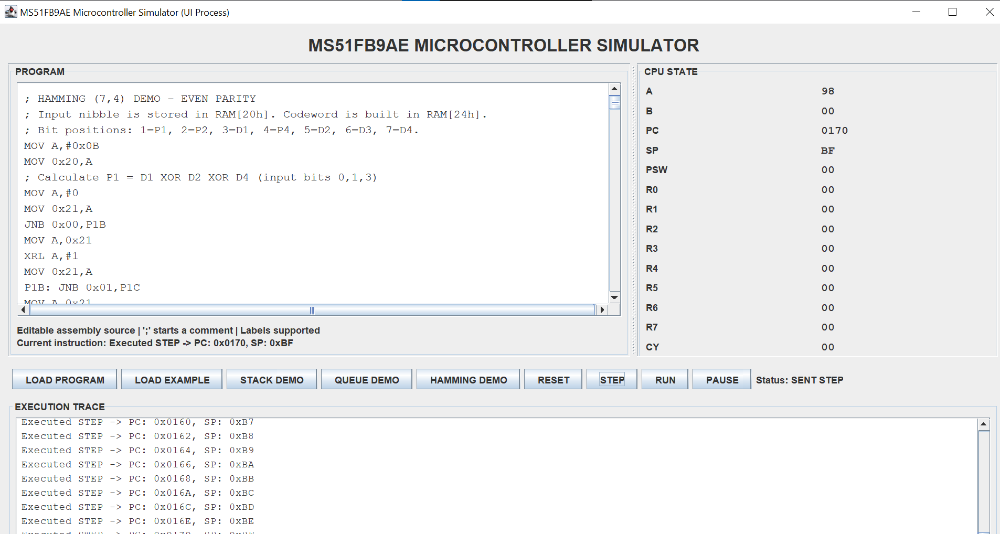

# Week 5 Observation Report

## Section 1: Scope of Review

This review covers the Week 5 editable assembly editor, the Hamming (7,4)
demonstration, and the simulator backend paths used by the demonstration:

- Hamming source and documentation in `DemoPrograms.java` and
  `WEEK5_HAMMING_IMPLEMENTATION.md`.
- CPU execution, arithmetic flags, relative branches, stack behavior, and
  instruction decoding.
- Queue metadata observation and IPC command/snapshot framing.

The review separates the controlled Hamming demonstration from defects in the
general simulator implementation.

## Section 2: Hamming (7,4) Verification

The demonstration uses input nibble `0x0B`, whose data bits are:

| Data bit | Value |
|---|---:|
| D1 | 1 |
| D2 | 1 |
| D3 | 0 |
| D4 | 1 |

For even parity:

- `P1 = D1 XOR D2 XOR D4 = 1`
- `P2 = D1 XOR D3 XOR D4 = 0`
- `P4 = D2 XOR D3 XOR D4 = 0`

Using the seven-bit layout `P1, P2, D1, P4, D2, D3, D4` gives
`1 0 1 0 1 0 1`, or **`0x55`**. With no injected error, the three syndrome
bits are all zero and the combined syndrome is `0`.

The correction jump table maps syndrome values 1 through 7 to codeword
positions 1 through 7. The routine is therefore correct for the documented
sample and for a controlled single-bit error in one of those positions.

The demonstration does not inject a corrupted codeword, recompute the
syndrome after correction, or distinguish multi-bit errors from correctable
single-bit errors. It validates the encoded sample rather than the simulator's
program-memory instruction stream.

## Section 3: Genuine Simulator Defects

### 3.1 SUBB carry-in handling

- **File / Method:** `src/Main/instruction/InstructionExecutor.java`,
  `InstructionExecutor.execute`, `SUBB_A_IMM` case.
- **Expected:** 8051 `SUBB` computes `A = A - data - CY`, with CY, AC, and OV
  calculated from the complete subtraction.
- **Actual:** The previous implementation computed `A = A - data` and ignored
  the incoming carry flag.
- **Fix applied:** The implementation now includes `CY` in the subtrahend and
  uses it when calculating borrow, auxiliary borrow, and overflow.

### 3.2 Queue count boundary handling

- **File / Method:** `src/Main/Queue/Queue.java`,
  `Queue.getContentsInOrder`.
- **Expected:** Queue contents should only be materialized for counts from
  `0` through the fixed capacity of `8`.
- **Actual:** Invalid RAM metadata could produce a negative array size or cause
  iteration beyond the eight-entry queue contract.
- **Fix applied:** Counts below `0` or above `8` now produce an explicit
  `IllegalStateException` instead of a `NegativeArraySizeException` or
  undefined observation.

### 3.3 IPC escaped-comma parsing

- **File / Method:** `src/Main/IPC/IPCProtocol.java`,
  `IPCProtocol.parseSnapshotData`.
- **Expected:** Escaped commas in status, instruction, or error text must
  remain part of the field value.
- **Actual:** Splitting on every comma corrupted values serialized with the
  protocol's `\c` escape.
- **Fix applied:** Snapshot fields now split on commas that are not preceded by
  an escape backslash.

## Section 4: Controlled Validation Tests

| Area | Controlled check | Expected result | Result |
|---|---|---|---|
| Hamming encoding | Encode `0x0B` with even parity | P1=1, P2=0, P4=0, codeword=`0x55` | Verified by bit calculation |
| Hamming syndrome | Validate the unmodified codeword | Syndrome=`0` | Verified by parity coverage |
| Hamming correction | Inject one bit flip and use syndrome table | Correct corresponding bit position | Mapping verified; runtime injection not performed |
| SUBB | Execute subtraction with CY set | Carry-in affects result and flags | Implemented; runtime test pending |
| Queue | Read count below 0 or above 8 | Explicit state error | Implemented; runtime test pending |
| IPC | Parse escaped comma in a serialized field | Field remains intact | Implemented; runtime test pending |

## Section 5: Unverified Observations & Limitations

- The environment used for this review did not have `javac` available, so the
  Java build and runtime test suite could not be executed here.
- Single-step execution executes one decoded instruction at a time and does
  not automatically halt the PC past `0x0170`; reaching that address is not,
  by itself, a proof that the loaded program has terminated.
- The Hamming routine is a demonstration over an encoded sample, not a
  protection layer for existing simulator source code or program-memory bytes.
- The queue remains assembly-managed through RAM metadata; the observer does
  not implement enqueue/dequeue operations or normalize invalid head/tail
  values.
- Hamming (7,4) correction is reliable for a single-bit error. Multiple
  simultaneous bit errors require an extended code or additional integrity
  checks.

## Section 6: Individual Contributions Summary

| Contribution | Week 5 work |
|---|---|
| Assembly and UI integration | Editable program source, two-pass assembly, labels, relative branches, and demo loading flow |
| Hamming demonstration | Even-parity encoding for `0x0B`, codeword construction, syndrome calculation, and single-bit correction mapping |
| CPU/backend audit and fixes | Corrected `SUBB` carry-in behavior, added queue count validation, and fixed escaped-comma IPC parsing |
| Verification and documentation | Documented expected Hamming values, controlled validation cases, limitations, and simulator observations |

